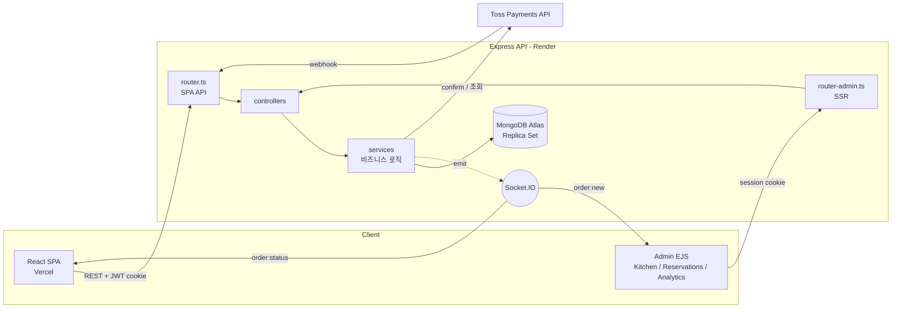
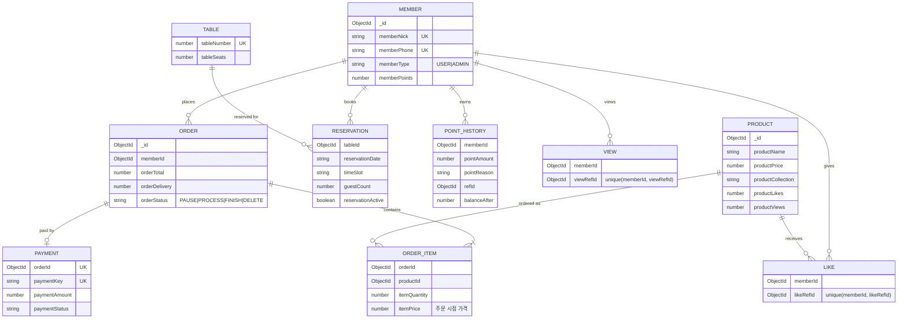

# 🍽️ Starbelly — 레스토랑 주문·예약 플랫폼 (Backend + Admin)

> 메뉴 주문, **토스페이먼츠 결제**, **실시간 주방 화면**, **동시성이 보장된 테이블 예약**, **포인트 원장**을 갖춘 레스토랑 서비스의 백엔드와 관리자 페이지입니다.
> 프론트엔드: [Starbelly-react-vite](https://github.com/Edwardd-stack/Starbelly-react-vite)

| | |
| --- | --- |
| **Stack** | Node.js 20 · Express · TypeScript · MongoDB(Mongoose) · Socket.IO · EJS |
| **Auth** | 사용자: JWT (httpOnly cookie) · 관리자: express-session (MongoDB store) |
| **Payment** | Toss Payments 결제위젯 (테스트 환경) |
| **Test / CI** | Jest · Supertest · mongodb-memory-server(Replica Set) · GitHub Actions |
| **Infra** | Docker · docker compose · Render · MongoDB Atlas |

---

## ✨ 핵심 기능

| 기능 | 설명 |
| --- | --- |
| 🛒 주문 | 장바구니 → 주문 생성. **금액은 서버가 DB의 메뉴 가격으로 계산** (클라이언트 가격은 무시) |
| 💳 결제 | Toss 결제위젯 → `/payment/confirm`에서 **금액 검증 + Idempotency-Key**로 승인, Webhook으로 상태 동기화 |
| ⚡ 실시간 주방 | 결제 완료 즉시 관리자 Kitchen 화면에 주문 표시, 조리 완료 시 고객 화면 자동 갱신 (Socket.IO Room) |
| 🪑 테이블 예약 | 날짜·인원·시간 → 배치도에서 테이블 선택. **동시 예약을 Unique Index로 차단 (409 Conflict)** |
| 🪙 포인트 | 주문 완료 시 1,000원당 1포인트. **원장(PointHistory) + 트랜잭션**으로 중복 적립 방지 |
| 📊 관리자 분석 | 일별 매출, 인기 메뉴 TOP5, 시간대별 주문량 (Aggregation Pipeline, KST 기준) |
| 🔐 보안 | Mass Assignment 차단(Whitelist), `runValidators`, bcrypt, httpOnly·SameSite 쿠키 |

---

## 🏗️ 아키텍처



**계층 구조:** `router → controller(HTTP 처리) → service(비즈니스 규칙) → schema(Mongoose 모델)`
SPA API와 관리자 페이지가 같은 service를 재사용합니다.

---

## 🗂️ ERD



---

## 💡 기술적 의사결정

**1. 주문 금액은 서버에서만 계산**
클라이언트는 `productId`와 수량만 보냅니다. 서버가 판매 중인 메뉴의 가격을 조회해 합계·배달비를 계산하고, `OrderItem.itemPrice`에 주문 시점 가격을 저장합니다. 이후 메뉴 가격이 바뀌어도 과거 주문 금액은 변하지 않습니다.

**2. JWT는 httpOnly 쿠키에**
`localStorage`의 토큰은 XSS 한 번이면 탈취됩니다. httpOnly 쿠키는 JS에서 읽을 수 없고, `SameSite`로 CSRF 위험을 줄입니다. 프론트엔드는 앱 시작 시 `/member/detail`로 로그인 상태를 확인합니다.

**3. 결제는 서버가 승인**
`successUrl`의 `amount`를 믿지 않고 DB의 `orderTotal`과 비교합니다. 승인 요청에 `Idempotency-Key`를 사용하고 `Payment.orderId`에 unique 제약을 걸어, 네트워크 재시도나 중복 요청에도 **결제는 한 번만** 처리됩니다.

**4. 포인트는 잔액이 아닌 원장으로**
`memberPoints`만 바꾸면 변경 이력을 추적할 수 없습니다. 모든 변동을 `PointHistory`에 기록하고, 주문 상태 변경 + 원장 기록 + `$inc` 잔액 갱신을 **하나의 트랜잭션**으로 묶었습니다. `(refId, pointReason)` unique 인덱스로 같은 주문에 대한 중복 적립을 막습니다.

**5. 실시간은 Polling 대신 WebSocket**
Socket.IO 연결 시 관리자는 세션 쿠키, 고객은 JWT 쿠키로 인증하고 각자의 Room(`admin`, `member:{id}`)에만 이벤트를 받습니다. 소켓은 "신호"만 전달하고, 실제 상태는 항상 DB와 REST API가 기준입니다.

---

## 🔥 트러블슈팅

### 1) 동시 예약 시 같은 테이블이 두 번 예약되는 문제
- **문제:** "조회 후 저장(check-then-insert)" 방식은 두 요청이 동시에 들어오면 둘 다 빈 자리로 판단해 둘 다 저장됩니다 (Race Condition).
- **해결:** 검사를 DB에 맡겼습니다. `(tableId, reservationDate, timeSlot)` **Partial Unique Index** (`reservationActive: true`인 예약만)를 만들고, 중복 키 에러(11000)를 **409 Conflict**로 변환했습니다. 취소된 예약은 인덱스에서 빠지므로 같은 자리를 다시 예약할 수 있습니다.
- **검증:** 같은 테이블·시간에 **10개의 요청을 동시에** 보내는 테스트 → 정확히 1개 `201`, 9개 `409` (`tests/reservation.test.ts`).

### 2) 회원가입 API로 관리자 권한 획득이 가능했던 문제 (Mass Assignment)
- **문제:** `req.body`를 그대로 저장해 `{"memberType":"ADMIN","memberPoints":99999}`를 보내면 관리자 계정이 만들어졌습니다. 관리자 수정 API도 `productViews` 등 임의 필드를 변경할 수 있었습니다.
- **해결:** 허용 필드 목록(Whitelist)만 받는 `pickFields` 유틸을 만들고, 권한·포인트 같은 필드는 서버가 직접 설정합니다. `findOneAndUpdate`에 `runValidators: true`를 추가해 enum 검증도 적용했습니다.
- **검증:** `tests/member.test.ts` — ADMIN을 보내도 USER, 포인트 0으로 생성.

### 3) 로컬에선 되는데 배포 빌드가 실패한 문제
- **문제:** 개발 서버(ts-node)는 정상인데 `tsc` 빌드가 `ignoreDeprecations` 설정 오류로 실패했고, 빌드 결과물(dist)에는 EJS·CSS가 복사되지 않아 관리자 페이지가 깨졌습니다.
- **해결:** 사용하지 않는 tsconfig 옵션을 제거하고, 빌드 후 `views/`, `public/`을 dist로 복사하는 스크립트를 추가했습니다. CI에서 타입 체크·테스트·빌드를 매 push마다 실행합니다.

---

## 📡 API

| Method | Path | Auth | 설명 |
| --- | --- | --- | --- |
| POST | `/member/signup` · `/member/login` | – | 회원가입·로그인 (httpOnly 쿠키 발급) |
| POST | `/member/logout` | JWT | 로그아웃 |
| GET | `/member/detail` · `/member/points` | JWT | 내 정보 · 포인트 내역 |
| POST | `/member/update` | JWT | 프로필 수정 (이미지 업로드) |
| GET | `/member/top-users` · `/member/restaurant` | – | 포인트 랭킹 · 매장 정보 |
| GET | `/product/all?order&page&limit&productCollection&search` | – | 메뉴 목록 (정렬·필터·검색·페이지) |
| GET | `/product/:id` | 선택 | 메뉴 상세 (로그인 시 조회수 1회만 증가, `meLiked`) |
| POST | `/product/:id/like` | JWT | 좋아요 토글 |
| POST | `/order/create` · `/order/cancel` | JWT | 주문 생성 (서버 금액 계산) · 결제 전 취소 |
| GET | `/order/all?orderStatus` | JWT | 내 주문 |
| POST | `/payment/confirm` | JWT | 토스 결제 승인 (금액 검증·멱등성) |
| POST | `/payment/webhook` | – | 토스 결제 상태 동기화 |
| GET | `/reservation/availability?date&guests` | – | 시간대별 빈 테이블 |
| POST | `/reservation/create` · `/reservation/cancel` | JWT | 예약 (중복 시 409) · 취소 |
| GET | `/reservation/my` | JWT | 내 예약 |
| — | `/admin/*` | Session | 메뉴·회원 관리, **Kitchen**, **Reservations**, **Analytics** |

---

## 🚀 실행 방법

```bash
# 1) 환경 변수
cp .env.example .env        # MONGO_URL 등 입력 (트랜잭션 사용 → Atlas 또는 Replica Set 필요)

# 2) 개발 서버
npm install
npm run start:dev           # http://localhost:3007/admin

# 3) 데모 메뉴 데이터
npm run seed

# 4) 테스트 (메모리 MongoDB Replica Set, 실제 DB 사용 안 함)
npm test

# Docker로 실행 (MongoDB Replica Set 포함)
docker compose up --build
```

## 📁 폴더 구조

```
src/
├── app.ts / server.ts      # Express 설정, HTTP + Socket.IO 서버
├── router.ts               # SPA(React) API
├── router-admin.ts         # 관리자(EJS) 라우트
├── controllers/            # HTTP 요청·응답
├── models/                 # *.service.ts — 비즈니스 로직
├── schema/                 # Mongoose 스키마 (인덱스 포함)
├── libs/
│   ├── enums/  types/      # 공통 enum·타입
│   ├── utils/              # sanitize(whitelist), toss, mongo, uploader
│   ├── socket.ts           # Socket.IO 인증·Room
│   └── Errors.ts / config.ts
├── views/  public/         # 관리자 페이지 (EJS, CSS, JS)
└── seed/                   # 데모 메뉴
tests/                      # Jest + Supertest
```
